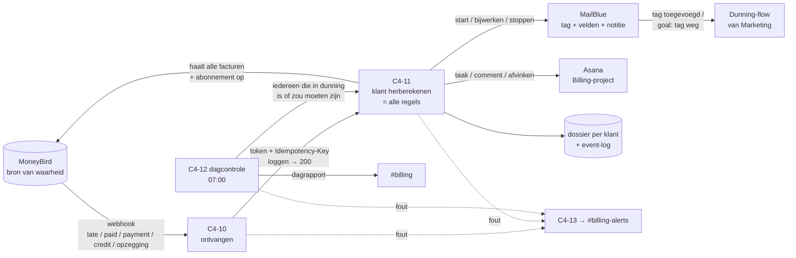

# Case 4: openstaande facturen automatisch opvolgen (n8n)

Werkende n8n-automation voor het moment waarop een factuur in **MoneyBird** vervalt. Er komt dan **één taak in Asana** voor Billing, de klant krijgt de tag **`billing-dunning-actief`** in **MailBlue**, en daarmee start de bestaande dunning-flow van Marketing. Betaalt de klant, wordt er gecrediteerd of wordt de factuur oninbaar verklaard, dan gaat de tag automatisch weer weg, stopt de flow en wordt de taak afgesloten.

De workflows zijn gebouwd met n8n 2.47 (self-hosted, lokaal) en [n8n-as-code](https://github.com/EtienneLescot/n8n-as-code). Ze staan als TypeScript in Git en worden naar n8n gepusht.

> **De antwoorden op de vier casevragen staan in [TOELICHTING.md](TOELICHTING.md).**

---

## In één zin

**Het event is de aanleiding, MoneyBird is de waarheid, en per klant wordt de stand herberekend.** Elke webhook (vervallen, betaald, deelbetaling, credit, storno, opzegging) leidt tot één vraag: *"hoe staat deze klant er nu voor in MoneyBird, en wijkt dat af van wat wij hebben gedaan?"* Uit dat antwoord volgt precies één actie: **starten, bijwerken, stoppen of niets**. Daardoor maakt het niet uit in welke volgorde webhooks binnenkomen, of ze dubbel komen of helemaal niet. Een dagelijkse controle draait dezelfde herberekening als vangnet.

## Wat er gebouwd is

| Workflow | Rol |
|---|---|
| **C4-10 Factuur-events ontvangen** | Het webhook-adres voor MoneyBird. Controleert de afzender, legt elk event vast (idempotent op `Idempotency-Key`), antwoordt 200 en geeft de klant door aan C4-11 |
| **C4-11 Klant herberekenen** | De kern. Alle dunning-regels op één plek, plus de acties in MailBlue (ActiveCampaign) en Asana |
| **C4-12 Dagelijkse controle** | Elke ochtend om 07:00 het vangnet voor gemiste of vastgelopen webhooks, plus een dagrapport in #billing |
| **C4-13 Foutafhandeling** | Error-workflow: een alert in #billing-alerts met een link naar de execution en "wat nu" |
| C4-00 Setup – Demo-data | Maakt de Data Tables aan en vult ze (ook de demo-reset). Plus `GET /webhook/c4-status` |
| C4-01 Mock – MoneyBird API | Zelfde paden, filters en velden als de MoneyBird API v2 (`sales_invoices`, `sales_invoices/{id}`, `subscriptions`) |
| C4-02 Mock – MoneyBird-simulator | "Er gebeurt iets in MoneyBird". Wijzigt de mock-data en stuurt een webhook in het **echte MoneyBird-formaat** naar C4-10 |

## Wat is echt en wat is een mock

| Systeem | Hier | Waarom |
|---|---|---|
| **MailBlue (ActiveCampaign)** | **Echt** (trial, API v3) | De tag, de velden en de notities zijn de kern van de case. MailBlue draait op ActiveCampaign. Ook de dunning-flow zelf staat er (3 mails met bedrag en betaallink, goal "tag weg"), gebouwd via de ActiveCampaign-MCP en inactief gelaten |
| **Asana** | **Echt** (gratis account) | Project "Billing – Openstaande facturen" met de secties Nieuw · In behandeling · Betalingsafspraak · Afgerond |
| MoneyBird | **Mock** (C4-01 API + C4-02 simulator, data in n8n Data Tables) | Zelfde endpoints, filtersyntax, payload-formaat (`webhook_token`, `entity_type`, `action`, `entity`) en `Idempotency-Key`-header als de echte. Voor productie wissel je alleen de base-URL en de credential, en registreer je de webhook. Een factuur vervalt in het echt pas na de vervaldatum, dus met een mock is elke situatie in een paar seconden af te spelen |
| Slack | Mock (Data Table `c4_slack_messages`) | De tekst is precies wat de Slack-node in productie post |
| Dossier + event-log | n8n Data Tables | In productie een echte database (of een Make-data store) met backups |

## De regels (node "Gewenste stand bepalen" in C4-11)

1. **Vervallen** = een factuur met state `late`/`reminded` en een openstaand bedrag. MoneyBird bepaalt dus wanneer iets vervalt, op basis van de betaaltermijn die Billing daar instelt.
2. **Creditfacturen starten nooit dunning.** Een creditfactuur die nog niet verrekend is, wordt wel afgetrokken van de factuur waar hij bij hoort.
3. **In dunning** als het totaal van de vervallen facturen ≥ **€ 5** is (Config). Lagere restbedragen leveren geen mails op, wel een comment voor Billing.
4. **Eén dossier per klant**: één Asana-taak en één tag, hoeveel facturen er ook openstaan. Een tweede vervallen factuur is een *update*, geen nieuwe start.
5. **Een opzegging stopt de dunning niet**, want de vordering blijft bestaan. Het veld *abonnement opgezegd* gaat op ja (zodat Marketing de tekst kan aanpassen) en Billing krijgt een comment.
6. **Stoppen** bij betaald, gecrediteerd, oninbaar of verwijderd. Bij een storno (betaling teruggedraaid) volgt een nieuwe ronde met een nieuwe taak die naar de vorige verwijst.

## Demo-scenario's ([`scenarios/`](scenarios/))

`python3 scripts/run_demo.py --reset` zet alles terug naar de beginstand (ActiveCampaign, Asana en de Data Tables) en speelt de 16 scenario's af. Daarna toont het de stand in alle systemen. Alle klant- en factuurdata is fictief.

| # | Scenario | Resultaat (geverifieerd) |
|---|---|---|
| 01 | Bakkerij De Korenaar: factuur vervalt | **Start**: Asana-taak, tag, velden (€ 59,00), notitie |
| 02 | Tweede factuur vervalt | **Bijwerken**: geen tweede taak, taaknaam € 118,00 (2 facturen) + comment |
| 03 | Deelbetaling € 40 (`payment_registered`, alleen factuur-ID) | **Bijwerken**: € 78,00 open |
| 04 | Eerste factuur betaald | **Bijwerken**: nog € 59,00 open |
| 05 | Alles betaald, en MoneyBird stuurt de push 2× | **Stoppen**: tag weg, status *betaald*, taak afgerond. Tweede push → `duplicate` |
| 06 | Vertraagde retry van het oude "late"-event | **Niets**: MoneyBird zegt nu "betaald" |
| 07–08 | Studio Noordlicht: vervalt → volledige creditfactuur | **Start** → **stoppen** (*gecrediteerd*) + verzoek aan Billing om te verrekenen |
| 09–11 | Fietsenmaker Spaak: vervalt → zegt op → oninbaar | **Start** → **bijwerken** (opgezegd = ja, dunning loopt door) → **stoppen** (*oninbaar*) |
| 12 | Kapsalon Knip: geen e-mailadres in MoneyBird | Asana-taak "handmatig opvolgen", geen tag, alert in #billing-alerts |
| 13 | Korenaar: storno (`payment_destroyed`) | **Start** nieuwe ronde, nieuwe taak met link naar de vorige |
| 14–15 | Hoveniers Groenrijk: vervalt, maar de webhook komt nooit aan → dagcontrole | Dagcontrole vindt de klant alsnog: **start** + dagrapport "1 correctie" |
| 16 | Webhook met een verkeerd token | **401**, niets gedaan |

## Zelf draaien

1. Importeer `export/*.json` in n8n, of push `workflows/local/*.workflow.ts` met `n8nac push`.
2. Credentials: *ActiveCampaign API*, *Asana API* (personal access token) en *Header Auth* "MoneyBird API (mock)" (`Authorization: Bearer …`, elke waarde werkt voor de mock).
3. `.env` vullen (zie `.env.example`), daarna:
   - `python3 scripts/setup_activecampaign.py`: tag, 8 contactvelden met personalisatietags en de demo-contacten
   - `python3 scripts/setup_asana.py`: project en secties

   Zet de ID's uit `mock-data/*_ids.json` in de **Config**-node van C4-11.
4. Activeer alle C4-workflows. Let op: **C4-13 moet ook actief zijn**, want in n8n 2.x start een error-workflow anders niet. Daarna `curl -X POST <n8n>/webhook/c4-setup`.
5. `python3 scripts/run_demo.py --reset`
6. In MailBlue: de dunning-automation volgens [docs/marketing-contract.md](docs/marketing-contract.md). In de trial staat hij al als "Dunning-flow (demo) – openstaande facturen", gebouwd via de ActiveCampaign-MCP, en bewust inactief.

## Repo-indeling

- [`TOELICHTING.md`](TOELICHTING.md): de antwoorden op de casevragen (ontwerp, triggers/tags/velden, edge cases, overdraagbaarheid)
- [`docs/`](docs/): de [handleiding voor Billing](docs/billing-handleiding.md), het [contract met Marketing](docs/marketing-contract.md), [beheer](docs/beheer.md) en de [dunning-flow in MailBlue](docs/mailblue-dunning-flow.md) (opbouw + mailteksten, export uit de trial)
- `workflows/local/`: de bron van de n8n-workflows (TypeScript, n8n-as-code). [`export/`](export/) bevat dezelfde workflows als n8n-JSON
- `scenarios/`, `scripts/`, `mock-data/`: demo, inrichting en fictieve data
- [`screenshots/`](screenshots/): canvassen, executions, Asana en MailBlue
- `AGENTS.md`, `.agents/`, `.github/agents/`: context die n8n-as-code genereert voor de AI-assistent (Claude Code)

Er staan geen credentials in deze repo.
